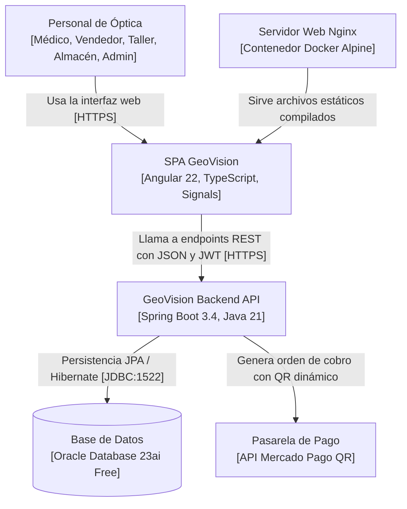

# GeoVision — Backend REST


API REST para la gestión integral de un centro óptico moderno: expediente clínico oftalmológico, exámenes visuales computarizados, emisión de recetas en PDF, ventas de mostrador y bajo receta con anticipo mínimo del 25%, pasarela digital integrada con Mercado Pago (QR dinámico), órdenes de trabajo para taller de biselado con control de calidad por lensometría, inventario y auditoría.

| Campo | Detalle |
| :--- | :--- |
| **Equipo** | [Apellido Paterno Materno, Nombres (Código)] · [Compañero 2, Nombres (Código)] |
| **Curso** | Lenguaje de Programación II · EP Ingeniería de Sistemas · UPeU · 2026-2 |
| **Docente** | Benjamin David Reyna Barreto |
| **Frontend** | [geovision-frontend](https://github.com/Samuel32430/geovisionFrontEnd) |
| **Video de demostración** | [Ver en YouTube (no listado)](URL_DEL_VIDEO_AQUI) |
| **Versión** | `v1.1-final` |

## Contenido

1. [Tecnologías](#1-tecnologías)
2. [Arquitectura (modelo C4)](#2-arquitectura-modelo-c4)
3. [Módulos y endpoints](#3-módulos-y-endpoints)
4. [Requisitos](#4-requisitos)
5. [Ejecución en desarrollo](#5-ejecución-en-desarrollo)
6. [Variables de entorno](#6-variables-de-entorno)
7. [Despliegue](#7-despliegue)
8. [Usuarios de prueba](#8-usuarios-de-prueba)
9. [Manejo de errores y logs](#9-manejo-de-errores-y-logs)
10. [Calidad del código](#10-calidad-del-código)
11. [Documentación y evidencias](#11-documentación-y-evidencias)
12. [Versiones](#12-versiones)
13. [Autores](#13-autores)

---

## 1. Tecnologías

| Componente | Versión | Uso |
| :--- | :--- | :--- |
| **Java** | 21 | Lenguaje de programación base (Records, Pattern Matching, Streams funcionales) |
| **Spring Boot** | 3.4.x | Web MVC, Data JPA, Validation, Security |
| **Oracle Database** | 23ai Free / 19c | Base de datos relacional empresarial con triggers, constraints y secuencias |
| **Apache PDFBox** | 3.0.x | Generación en memoria y streaming directo de recetas médicas oftálmicas en PDF |
| **Mercado Pago SDK** | 2.1.x | Generación de órdenes de cobro con QR dinámico y webhook ipn |
| **JJWT** | 0.12.6 | Tokens JWT firmados con algoritmo HMAC-SHA256 |
| **springdoc-openapi** | 2.8.x | Documentación interactiva Swagger UI / OpenAPI 3 |
| **JaCoCo / SonarQube** | 0.8.12 / Community | Análisis estático de código, cobertura de pruebas unitarias y Quality Gate |

---

## 2. Arquitectura (modelo C4)



La SPA (Angular) se comunica con la API mediante peticiones HTTP/JSON sobre HTTPS adjuntando un token criptográfico JWT en la cabecera `Authorization: Bearer <token>`.  
El servidor Nginx sirve la aplicación cliente y enruta las peticiones de negocio hacia la API REST en Spring Boot, la cual ejecuta las reglas transaccionales de negocio, la validación de anticipos del 25%, la emisión de recetas oftálmicas y persiste el modelo relacional en Oracle Database 23ai Free. Los diagramas detallados y modelos se encuentran en `docs/arquitectura/`.

---

## 3. Módulos y endpoints

```
src/main/java/pe/edu/upeu/geovision_backend/
├── config/         Configuraciones globales (SecurityConfig, CORS, OpenAPI, MailConfig)
├── controller/     Controladores REST organizados por dominio funcional
│   ├── atencion/           Consulta médica, refracción y recetas PDF
│   ├── gestion_comercial/  Clientes y cotizaciones
│   ├── inventario/         Productos, categorías, movimientos y stock
│   ├── orden_trabajo/      Órdenes de taller, lensometría y control de calidad
│   ├── security/           Autenticación (/auth/login) y recuperación de contraseña
│   └── ventas/             Punto de venta, amortizaciones, deudas y Mercado Pago
├── dto/            Data Transfer Objects de petición, respuesta y proyecciones
├── entity/         Entidades JPA con mapeo relacional a Oracle Database
├── enums/          Enumeraciones (Rol, EstadoVenta, EstadoOrden, TipoLente)
├── exception/      GlobalExceptionHandler y excepciones de negocio personalizadas
├── mapper/         Mapeo desacoplado Entity <-> DTO con MapStruct
├── repository/     Interfaces Spring Data JPA con consultas JPQL y nativas
├── security/       Filtros JwtAuthenticationFilter, JwtService y UserDetailsService
├── service/        Lógica de negocio transaccional (@Service, @Transactional)
└── util/           Generador en memoria Apache PDFBox y formateadores
```

Todos los endpoints se exponen bajo la ruta base `/api/v1`. Cada endpoint protegido exige un **permiso formal**, nunca el nombre directo de un rol.

| Módulo | Endpoints | Permiso |
| :--- | :--- | :--- |
| **Autenticación** | `POST /auth/login` · `POST /auth/recuperar-password` · `POST /auth/reset-password` | Público |
| | `GET /auth/me` | Autenticado |
| **Atención Médica** | `GET /atenciones` · `GET /atenciones/{id}` · `GET /recetas/{id}/pdf` | `ATENCION_LEER` |
| | `POST /atenciones` · `PUT /atenciones/{id}` · `POST /recetas` | `ATENCION_REGISTRAR` |
| **Ventas** | `GET /ventas` · `GET /ventas/{id}` · `GET /ventas/buscar` | `VENTAS_LEER` |
| | `POST /ventas` (con regla de anticipo mín. 25%) · `POST /ventas/mercadopago/qr` | `VENTAS_REGISTRAR` |
| **Cobranza y Amortización** | `GET /ventas/cuentas-por-cobrar` · `GET /ventas/deudas-pendientes` | `VENTAS_LEER` |
| | `POST /ventas/amortizaciones` (cobro de saldo deudor) | `VENTAS_REGISTRAR` |
| **Órdenes de Trabajo** | `GET /ordenes-trabajo` · `GET /ordenes-trabajo/{id}` | `TALLER_LEER` |
| | `POST /ordenes-trabajo` · `PUT /ordenes-trabajo/{id}/estado` | `TALLER_REGISTRAR` |
| **Control de Calidad** | `POST /ordenes-trabajo/{id}/lensometria` · `PUT /control-calidad` | `CALIDAD_VERIFICAR` |
| **Inventario** | `GET /productos` · `GET /productos/{id}` · `GET /kardex` | `CATALOGO_LEER` |
| | `POST /productos` · `PUT /productos/{id}` · `POST /movimientos-stock` | `CATALOGO_ESCRIBIR` |
| **Seguridad y Usuarios** | `GET /usuarios` · `GET /roles` · `GET /auditoria` | `USUARIOS_ADMINISTRAR` |
| | `POST /usuarios` · `PUT /usuarios/{id}` · `PUT /usuarios/{id}/roles` | `USUARIOS_ADMINISTRAR` |

Documentación interactiva disponible en: `<http://localhost:8080/swagger-ui.html>` (solo perfil `dev`).

---

## 4. Requisitos

* **JDK 21 LTS** (el Maven Wrapper `./mvnw` viene incluido).
* **Docker Desktop** (para la base de datos Oracle Database 23ai Free).
* **Puertos libres requeridos:**
  * `8080` (API Backend Spring Boot)
  * `1522` (Base de Datos Oracle)

---

## 5. Ejecución en desarrollo

```bash
# 1. Iniciar la base de datos Oracle en contenedor Docker
docker run -d --name geovision-oracle -p 1522:1521 \
  -e ORACLE_PASSWORD=oracle \
  -e APP_USER=geovisionBackEnd \
  -e APP_USER_PASSWORD=oracle \
  gvenzl/oracle-free:23-slim

# 2. Ejecutar la API (perfil dev activo por defecto)
./mvnw spring-boot:run          # En Linux / macOS
# En Windows:
.\mvnw.cmd spring-boot:run
```

Los scripts DDL y el seed data de prueba (`database/`) se cargan automáticamente al inicializar la base de datos.  
**Comprobación rápida:** `GET http://localhost:8080/api/v1/health` o apertura de Swagger en `<http://localhost:8080/swagger-ui.html>`.

---

## 6. Variables de entorno (perfil prod)

| Variable | Propósito | Ejemplo (no real) |
| :--- | :--- | :--- |
| `SPRING_PROFILES_ACTIVE` | Perfil activo de configuración | `prod` |
| `DB_URL` | Cadena JDBC de conexión a Oracle | `jdbc:oracle:thin:@//db.geovision.pe:1522/FREEPDB1` |
| `DB_USERNAME` / `DB_PASSWORD` | Credenciales de conexión a Oracle | `geovision_app` / `********` |
| `JWT_SECRET` | Clave secreta Base64 (mín. 256 bits) para HMAC-SHA256 | `generar con openssl rand -base64 48` |
| `MP_ACCESS_TOKEN` | Token de acceso de producción para Mercado Pago | `APP_USR-782163-112015-abcdef...` |
| `MAIL_USERNAME` / `MAIL_PASSWORD` | Credenciales SMTP para envío de recuperación | `notificaciones@geovision.pe` / `********` |
| `FRONTEND_ORIGINS` | Orígenes web permitidos por la política CORS | `https://geovision.pe` |

*En perfil `prod` Swagger UI está deshabilitado y los logs no exponen sentencias SQL.*

---

## 7. Despliegue

```bash
# Compilar y empaquetar el artefacto JAR omitiendo pruebas
./mvnw clean package -DskipTests

# Ejecutar el artefacto en modo producción
SPRING_PROFILES_ACTIVE=prod java -jar target/geovisionBackEnd-0.0.1-SNAPSHOT.jar
```

**Volver a la versión anterior:** `git checkout v1.0-demo`, compilar y ejecutar. Las estructuras de tablas mantienen compatibilidad regresiva con la versión previa.

---

## 8. Usuarios de prueba

> **Nota de seguridad:** Las contraseñas de las cuentas de demostración se entregan directamente al docente en el informe académico; no se publican en este repositorio abierto.

| Usuario | Rol | Permisos |
| :--- | :--- | :--- |
| `admin` | `ADMIN` | Todos los módulos, auditoría y administración de usuarios |
| `optometra` | `OPTOMETRA` | Expedientes clínicos, atención médica y emisión de recetas PDF |
| `vendedor` | `VENDEDOR` | Catálogo (leer), clientes, registro de ventas y amortizaciones |
| `taller` | `TECNICO_TALLER` | Órdenes de trabajo, biselado y lensometría de calidad |
| `almacen` | `ALMACENERO` | Catálogo (leer/escribir), entradas de stock y control de Kardex |

---

## 9. Manejo de errores y logs

Todos los errores de la API devuelven una estructura uniforme capturada centralizadamente por `GlobalExceptionHandler`:

```json
{
  "timestamp": "2026-11-20T11:22:05.112",
  "status": 409,
  "error": "Conflict",
  "mensaje": "El anticipo no puede ser menor al 25% del total de la venta.",
  "ruta": "/api/v1/ventas",
  "requestId": "a71c09de",
  "errores": null
}
```

| Código | Cuándo ocurre |
| :---: | :--- |
| **400** | Datos inválidos de petición (`errores` contiene el detalle de validación por campo) |
| **401** | Sin cabecera de autenticación, token JWT inválido o expirado |
| **403** | Falta el permiso específico requerido para ejecutar la acción |
| **404** | El recurso solicitado no existe |
| **409** | Violación de regla de negocio (stock insuficiente, anticipo menor al 25%, saldo deudor al entregar) |
| **500** | Error interno no esperado: mensaje sanitizado para el cliente con su respectivo `requestId` |

Cada línea del log (`logs/geovision.log`, rotación diaria) incluye el identificador `requestId`, enviado también en la cabecera HTTP `X-Request-Id`.  
Para rastrear un error en el servidor: `grep a71c09de logs/geovision.log`.

---

## 10. Calidad del código (SonarQube)

```bash
# Levantar servidor SonarQube local con Docker
docker compose -f docs/calidad/docker-compose.sonarqube.yml up -d    # http://localhost:9000

# Ejecutar análisis estático y pruebas con cobertura
./mvnw clean verify org.sonarsource.scanner.maven:sonar-maven-plugin:5.5.0.6356:sonar \
  -Dsonar.token=$SONAR_TOKEN
```

| Métrica (v1.1-final) | Resultado |
| :--- | :---: |
| **Quality Gate LP2-Curso** | ✅ **Passed** |
| **Confiabilidad · Seguridad · Mantenibilidad** | **A · A · A** |
| **Hotspots de Seguridad Revisados** | **100 %** |
| **Cobertura de Pruebas** | **36,4 %** |
| **Duplicación de Código** | **1,1 %** |

Detalle de incidencias atendidas y remediadas: `docs/calidad-sonarqube.md`.

---

## 11. Documentación y evidencias

| Documento | Enlace |
| :--- | :--- |
| Índice de evidencias | `docs/README.md` |
| Arquitectura C4 y Flujos | `docs/MANUAL_ARQUITECTURA_FLUJOS_GEOVISION.md` |
| Matriz de casos de la API y pruebas | `docs/INFORME_TECNICO_ITERACION_2_GEOVISION.md` |
| Guía de Sustentación y Exposición | `docs/GUIA_EXPOSICION_LENGUAJE_PROGRAMACION_GEOVISION.md` |
| Registro de decisiones arquitecturales (ADR) | `docs/ADR_ARQUITECTURALES_GEOVISION.xlsx` |
| Entrega de Base de Datos Oracle | `docs/ENTREGABLE_ADMINISTRACION_BASE_DATOS_II_GEOVISION.md` |
| Calidad y SonarQube | `docs/calidad-sonarqube.md` |

---

## 12. Versiones

| Etiqueta | Fecha | Descripción |
| :--- | :---: | :--- |
| `v1.0-demo` | 18/11/2026 | Versión demostrativa presentada en la primera sustentación |
| `v1.1-final` | 25/11/2026 | Versión final con observaciones de demostración atendidas (corrección SMTP, anticipo 25% y Mercado Pago) |

---

## 13. Autores

| Integrante | Aporte principal |
| :--- | :--- |
| **[Apellido Paterno Materno, Nombres]** | Seguridad perimetral JWT, autenticación, módulo de ventas, anticipos y pasarela Mercado Pago |
| **[Compañero 2, Nombres]** | Atención clínica, expedientes oftalmológicos, recetas PDFBox, órdenes de trabajo y calidad |

---

> *Proyecto académico · Lenguaje de Programación II · Universidad Peruana Unión · 2026-2*
