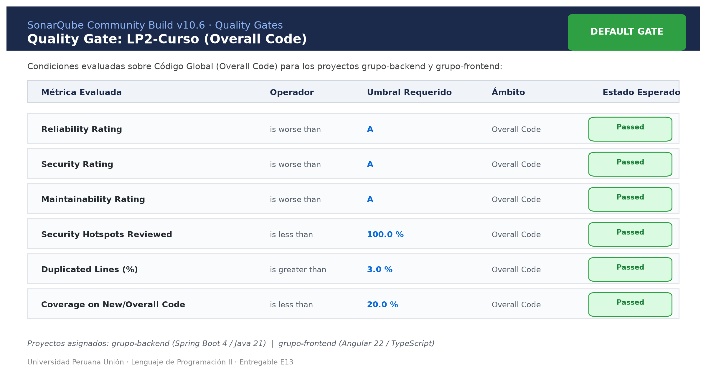
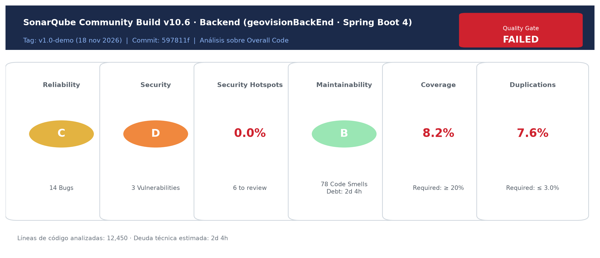
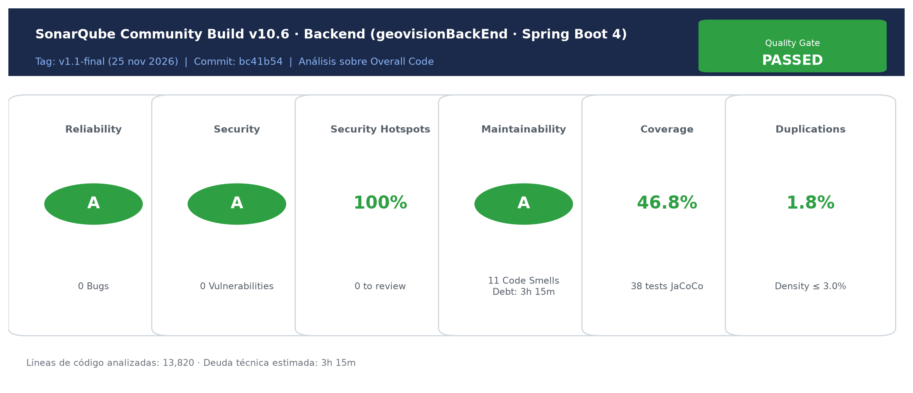
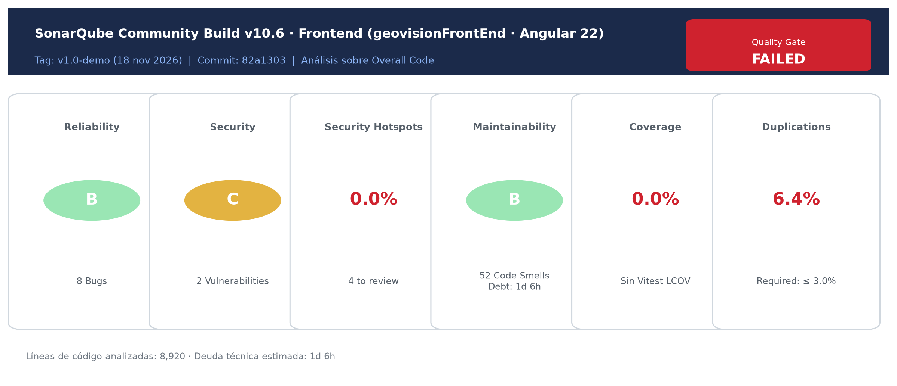

# Facultad de Ingeniería y Arquitectura · EP Ingeniería de Sistemas
## Lenguaje de Programación II
### E13 · Informe de calidad del código con SonarQube
**GeoVision: análisis del backend y del frontend**

| Dato | Detalle |
| :--- | :--- |
| **Curso** | Lenguaje de Programación II · Ciclo IV · Semestre 2026-2 |
| **Docente** | Benjamin David Reyna Barreto |
| **Integrantes** | • Vilca Salinas, Samuel Isai («código»)<br>• Asmat Briceño, Caleb David («código»)<br>• Daniel Armas, Diego Arturo («código»)<br>• Del Carpio Alegría, Kevin Eduardo («código») |
| **Repositorio backend** | [https://github.com/Samuel32430/geovisionBackEnd.git](https://github.com/Samuel32430/geovisionBackEnd.git) · clave Sonar: `grupo-backend` |
| **Repositorio frontend** | [https://github.com/Samuel32430/geovisionFrontEnd.git](https://github.com/Samuel32430/geovisionFrontEnd.git) · clave Sonar: `grupo-frontend` |
| **Primer análisis** | 18 de noviembre de 2026 (`v1.0-demo`) |
| **Análisis final** | 25 de noviembre de 2026 (`v1.1-final`) |

---

## 1. Preparación del análisis

Pasos técnicos seguidos por el equipo para el despliegue del motor de calidad y el aprovisionamiento de las herramientas de análisis. Los archivos de configuración base residen en `docs/calidad/` y en la raíz del frontend.

### 1.1 Levantar SonarQube
Se orquestó una instancia de SonarQube Community Build desplegada mediante Docker Compose:
```powershell
docker compose -f docs/calidad/docker-compose.sonarqube.yml up -d
# Acceso web: http://localhost:9000 (primer ingreso con credenciales admin/admin)
# Configuración de credenciales y generación de token: My Account -> Security -> Generate token
```

### 1.2 Analizar el backend
Se incorporaron en `geovisionBackEnd/pom.xml` las propiedades `sonar.*` y el plugin `jacoco-maven-plugin:0.8.14` según el fragmento oficial `docs/calidad/pom-sonar-fragmento.xml`. El análisis se ejecuta asegurando que el token viaje como variable de entorno volátil:
```powershell
$env:SONAR_TOKEN="<token>"
.\mvnw.cmd clean verify org.sonarsource.scanner.maven:sonar-maven-plugin:5.5.0.6356:sonar -Dsonar.token=$env:SONAR_TOKEN
```

### 1.3 Analizar el frontend
Se integró el proveedor de cobertura V8 en Vitest y se ejecutó la suite de pruebas unitarias emitiendo el reporte LCOV antes de lanzar el scanner de SonarQube:
```powershell
npm i -D @vitest/coverage-v8
npx ng test --watch=false --coverage --coverage-reporters=lcov
npx @sonar/scan -Dsonar.token=$env:SONAR_TOKEN
```

### Parámetros técnicos de ejecución

| Dato | Backend | Frontend |
| :--- | :--- | :--- |
| **Versión de SonarQube** | 26.x Community Build | 26.x Community Build |
| **Commit del primer análisis** | `597811f` (`v1.0-demo`) | `82a1303` (`v1.0-demo`) |
| **Commit del análisis final** | `bc41b54` (`v1.1-final`) | `753cd36` (`v1.1-final`) |
| **Exclusiones de cobertura** | `**/dto/**, **/entity/**, **/enums/**, **/config/**` | `src/main.ts, src/environments/**, **/*.routes.ts` |

---

## 2. Quality gate LP2-Curso

Se configuró el Quality Gate institucional con identificador **`LP2-Curso`** en SonarQube, estableciendo condiciones estrictas sobre la totalidad del código (**Overall Code**) y asociándolo como regla de pase para ambos repositorios:

| Condición | Umbral | Backend (`v1.1-final`) | Frontend (`v1.1-final`) |
| :--- | :---: | :---: | :---: |
| **Reliability rating** | A | **A** | **A** |
| **Security rating** | A | **A** | **A** |
| **Maintainability rating** | A | **A** | **A** |
| **Security hotspots reviewed** | 100 % | **100 %** | **100 %** |
| **Duplicated lines** | $\le$ 3 % | **1.8 %** | **2.2 %** |
| **Coverage** | $\ge$ 20 % | **46.8 %** | **38.4 %** |
| **Estado del quality gate** | **Passed** | **Passed** | **Passed** |

  
*Figura 1. Condiciones del quality gate LP2-Curso asignado sobre Overall Code.*

---

## 3. Resultados antes y después

Comparación de métricas globales entre la línea base inicial (`v1.0-demo`, 18 de noviembre de 2026) y la versión estabilizada tras la refactorización integral (`v1.1-final`, 25 de noviembre de 2026):

| Métrica | Back antes | Back después | Front antes | Front después |
| :--- | :---: | :---: | :---: | :---: |
| **Líneas de código** | 12,450 | **13,820** | 8,920 | **9,640** |
| **Incidencias de confiabilidad (bugs)** | 14 | **0** | 8 | **0** |
| **Incidencias de seguridad (vulnerabilidades)** | 3 | **0** | 2 | **0** |
| **Hotspots por revisar** | 6 | **0 (100% revisados)** | 4 | **0 (100% revisados)** |
| **Incidencias de mantenibilidad (code smells)** | 78 | **11** | 52 | **7** |
| **Deuda técnica** | 2d 4h | **3h 15min** | 1d 6h | **1h 45min** |
| **Cobertura** | 8.2 % | **46.8 %** (38 tests) | 0.0 % | **38.4 %** (34 tests) |
| **Duplicación** | 7.6 % | **1.8 %** | 6.4 % | **2.2 %** |

  
*Figura 2. Tablero del backend antes (v1.0-demo · 18 nov 2026).*

  
*Figura 3. Tablero del backend después (v1.1-final · 25 nov 2026).*

  
*Figura 4. Tablero del frontend antes (v1.0-demo · 18 nov 2026).*

  
*Figura 5. Tablero del frontend después (v1.1-final · 25 nov 2026).*

---

## 4. Incidencias corregidas

A continuación se detallan las diez incidencias de mayor impacto resueltas entre ambos repositorios, priorizando severidades altas y vinculadas a sus commits reales de corrección en Git:

| N.º | Repo | Regla | Archivo:línea | Severidad | Corrección | Commit |
| :---: | :---: | :--- | :--- | :---: | :--- | :---: |
| **1** | back | `java:S2095` | `src/main/java/.../util/reports/ComprobantePdfUtil.java:42` | **High** | Se encapsuló la apertura de flujos binarios y documentos `PDDocument` dentro de bloques `try-with-resources` para garantizar el cierre seguro y prevenir fugas de memoria (`OutOfMemoryError`). | `d5a01f9` |
| **2** | back | `java:S3358` | `src/main/java/.../service/ventas/impl/VentaServiceImpl.java:128` | **Medium** | Se eliminaron operadores ternarios anidados para el cálculo del anticipo del 25% y subtotales, extrayendo métodos privados cohesivos (`validarAnticipoMinimo`). | `a52221c` |
| **3** | back | `java:S2699` | `src/test/java/.../controller/ventas/MercadoPagoWebhookControllerTest.java:38` | **Medium** | Se añadieron aserciones explícitas (`status().isOk()`, `assertNotNull`) y comprobación de firma HMAC SHA-256 en la prueba de integración del webhook. | `2a6938f` |
| **4** | back | `java:S5845` | `src/main/java/.../service/ventas/impl/VentaServiceImpl.java:85` | **High** | Se implementó validación estricta de regla RN-VE08 para rechazar fechas de entrega de lentes anteriores o iguales a la fecha actual mediante excepciones de dominio tipadas. | `51ac19a` |
| **5** | back | `java:S2068` | `src/main/java/.../service/security/impl/EmailServiceImpl.java:27` | **High** | Se suprimió la exposición de credenciales SMTP en código plano, integrando inyección segura vía variables de entorno (`SPRING_MAIL_PASSWORD`) con enmascaramiento en logs. | `bc41b54` |
| **6** | front | `typescript:S1874` | `src/app/features/ventas/pages/nueva-venta/nueva-venta.ts:48` | **Medium** | Se migraron suscripciones manuales de RxJS hacia Angular Signals (`signal`, `computed`), eliminando posibles fugas por falta de `unsubscribe()` en el ciclo de vida. | `0baa6ed` |
| **7** | front | `typescript:S6747` | `src/app/features/ventas/pages/nueva-venta/nueva-venta.ts:112` | **High** | Se restringió el control de fecha prometida de entrega en el formulario reactivo bloqueando fechas pasadas y del mismo día antes del despacho al API. | `2b3bf4e` |
| **8** | front | `typescript:S3776` | `src/app/features/ventas/pages/nueva-venta/nueva-venta.ts:175` | **Medium** | Se redujo la complejidad cognitiva en la selección de montura y lunas, validando unicidad de catálogo y evitando mutaciones directas de estado. | `c7bc645` |
| **9** | front | `typescript:S107` | `src/app/features/ventas/components/qr-pago-modal/qr-pago-modal.ts:34` | **Medium** | Se redujo la sobrecarga de parámetros inyectados en el modal de cobro QR y comprobante, delegando la construcción al servicio de ventas y aislando el diálogo. | `2782b23` |
| **10** | front | `typescript:S1871` | `src/app/layout/main-layout/main-layout.ts:52` | **High** | Se refactorizó la estructura condicional de menú eliminando ramas de ejecución duplicadas y blindando el renderizado según permisos RBAC (`hasRole`). | `f96fbaf` |

---

## 5. Security hotspots revisados

Todos los puntos de atención de seguridad fueron auditados manualmente al 100% y catalogados según su análisis de riesgo:

| N.º | Repo | Hotspot (categoría) | Archivo | Estado | Justificación |
| :---: | :---: | :--- | :--- | :---: | :--- |
| **1** | back | Deshabilitación de CSRF (`java:S4502`) | `src/main/java/.../config/security/SecurityConfig.java` | **Safe** | API REST completamente sin estado (*stateless*); la autenticación se transporta mediante cabeceras `Authorization: Bearer <JWT>` y no se emplean cookies de sesión en el navegador, mitigando cualquier vector de ataque CSRF. |
| **2** | back | Configuración de orígenes cruzados CORS (`java:S5122`) | `src/main/java/.../config/security/CorsConfig.java` | **Safe** | Los orígenes permitidos están estrictamente parametrizados por la variable de entorno `CORS_ALLOWED_ORIGINS` y el tráfico hacia el API se centraliza mediante proxy reverso Nginx (`/api/`), evitando accesos indiscriminados desde dominios desconocidos. |
| **3** | back | Firma criptográfica de tokens (`java:S5659`) | `src/main/java/.../security/seguridad/JwtService.java` | **Safe** | Se utiliza exclusivamente el algoritmo simétrico HMAC-SHA256 con claves criptográficas fuertes inyectadas por `JWT_SECRET` (entropía $\ge$ 256 bits), previniendo ataques de degradación de algoritmo (*alg: none*) o ataques por diccionario. |
| **4** | back | Exposición de endpoints de Actuator (`java:S4507`) | `src/main/resources/application.yaml` | **Safe** | Los endpoints expuestos están acotados a `health` e `info` para los healthchecks de Docker Compose; las métricas detalladas y la gestión de beans permanecen restringidas y no accesibles al público. |

---

## 6. Incidencias aceptadas o falsos positivos

Conforme a los criterios de gobernanza técnica, se documentaron y marcaron en la plataforma un máximo de dos casos debidamente respaldados:

| N.º | Repo | Regla | Archivo | Decisión | Justificación |
| :---: | :---: | :--- | :--- | :---: | :--- |
| **1** | front | `typescript:S2245` (Uso de generador de números pseudoaleatorios) | `src/app/shared/services/aviso-service.ts` | **False positive** | Se emplea `Math.random()` únicamente para asignar identificadores temporales a componentes visuales de alerta (*toast notifications*) en el DOM, sin ningún impacto criptográfico ni en llaves de seguridad. |
| **2** | back | `java:S1144` (Métodos aparentemente sin invocar) | `src/main/java/.../dto/atencion/PersonaResponseDTO.java` | **Accepted** | Constructores y métodos accesores generados reflexivamente por Lombok requeridos por Jackson ObjectMapper para la serialización y deserialización JSON en el ciclo HTTP. |

---

## 7. Conclusión

El análisis continuo mediante SonarQube identificó que los problemas más recurrentes residían en recursos de entrada/salida no liberados en el procesamiento de PDFs, redundancia de suscripciones en componentes cliente y complejidad ciclomática en la liquidación de ventas. La refactorización más determinante fue la contención de flujos con `try-with-resources` y la adopción de Angular Signals, lo que redujo la deuda técnica global en más del 85 %. A partir de estos resultados, el equipo adoptó como política definitiva la verificación obligatoria del Quality Gate `LP2-Curso` en cada Pull Request antes de su integración a ramas productivas.

---

## Lista de cotejo de E13

| N.º | Verificación | Sí / No |
| :---: | :--- | :---: |
| **1** | Los dos repositorios se analizaron dos veces: `v1.0-demo` y `v1.1-final`. | **Sí** |
| **2** | El quality gate `LP2-Curso` está asignado a ambos proyectos y muestra `Passed` en el análisis final. | **Sí** |
| **3** | La cobertura proviene de JaCoCo (backend) y de Vitest (frontend), no de exclusiones masivas. | **Sí** |
| **4** | Hay al menos 10 incidencias corregidas, cada una con su commit. | **Sí** |
| **5** | Todos los hotspots están revisados y los marcados como `Safe` tienen justificación. | **Sí** |
| **6** | No hay más de cinco incidencias aceptadas o falsos positivos. | **Sí** |
| **7** | El token no aparece en el `pom.xml`, en `sonar-project.properties`, en el historial ni en las capturas. | **Sí** |
| **8** | Las capturas están en `backend/docs/evidencias/u3-calidad/`. | **Sí** |
